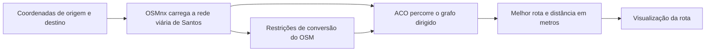
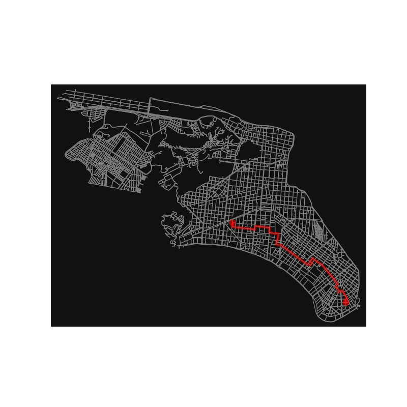

# 🐜 Otimização de Rotas Urbanas com ACO

Projeto acadêmico que procura uma rota curta entre dois pontos de Santos (SP) usando **Otimização por Colônia de Formigas** (*Ant Colony Optimization*, ACO) sobre a malha viária do OpenStreetMap. O objetivo é minimizar a distância percorrida, respeitando o sentido das ruas e um conjunto de restrições de conversão.

## Como funciona



1. `index.py` carrega as ruas para carros e associa as coordenadas aos nós mais próximos.
2. `restricoes.py` converte relações do OpenStreetMap em conversões proibidas no grafo.
3. `aco1.py` executa as formigas, atualiza os feromônios e guarda a melhor rota encontrada.
4. O programa imprime a distância e desenha a rota sobre a rede viária.

O custo padrão de cada aresta é `length`, em metros. Portanto, esta versão otimiza **distância**, não tempo de viagem, trânsito ou segurança.

## A ideia do ACO neste projeto

Cada formiga constrói um caminho da origem até o destino. Em cada cruzamento, ela escolhe aleatoriamente entre as próximas ruas permitidas. A chance de escolher uma aresta aumenta quando ela tem mais feromônio e diminui quando ela é mais longa:

`peso = feromonio ** alfa × (1 / distância) ** beta`

Depois de cada iteração, os feromônios evaporam. Por padrão, a melhor rota válida daquela iteração recebe um depósito proporcional a `Q / custo`. Isso favorece caminhos curtos que voltam a ser encontrados, sem deixar de explorar alternativas.

## Restrições de rota

- A rede é dirigida (`network_type="drive"`), então o algoritmo segue os sentidos representados no grafo.
- Cada formiga evita visitar o mesmo nó duas vezes.
- Relações permanentes do OSM com uma única interseção (`via` como nó) são convertidas em triplas `(nó anterior, interseção, próximo nó)` proibidas.
- O código trata regras `no_*` e `only_*`. Restrições condicionais, vias compostas e relações que não correspondem às arestas carregadas são ignoradas ou reportadas como aviso.

Essa cobertura representa as regras implementadas pelo projeto; ela não garante reproduzir todas as regras de circulação do mundo real.

## Executar

Requisitos identificados no código: Python, `osmnx` e `matplotlib`. O projeto não fixa versões em um arquivo de dependências.

```powershell
python -m venv .venv
.\.venv\Scripts\Activate.ps1
python -m pip install osmnx matplotlib
python index.py
```

É necessária conexão à internet para carregar a rede do OpenStreetMap. Também é necessário ter o arquivo `restricoes_osm.json` na pasta do projeto: ele é usado localmente, mas está ignorado pelo Git neste repositório. Sem esse arquivo, a execução para com erro de leitura.

## Configuração atual

O teste executado por `index.py` está definido em `ROTAS_TESTE`: origem e destino, `24.258` formigas, `7.541` iterações e semente aleatória `42`. Os parâmetros `alfa`, `beta`, evaporação e quantidade de depositantes usam os valores padrão de `aco1.py`. A configuração atual cria cerca de 183 milhões de tentativas de construção de caminho; o tempo de execução pode ser alto.

## Arquivos principais

| Arquivo | Papel |
| --- | --- |
| `index.py` | Configura a área, os pontos, os parâmetros e a visualização. |
| `aco1.py` | Implementa o ACO aplicado à rota na rede viária. |
| `restricoes.py` | Lê relações OSM e mapeia conversões proibidas para o grafo. |
| `restricoes_osm.json` | Dados locais das relações de restrição usados pelo programa; ignorados pelo Git. |
| `imagens/` | Imagens de rotas de exemplo. |

### Exemplo de visualização



Imagem ilustrativa de uma rota registrada no projeto; ela não garante o resultado da configuração atual.

Os dados cartográficos são do OpenStreetMap e estão sujeitos à licença ODbL. **© OpenStreetMap contributors**.
